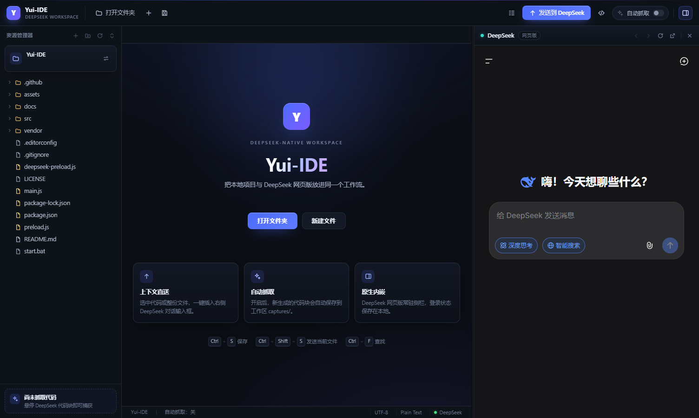

# Yui-IDE-DeepSeek

一个把 DeepSeek 网页版嵌入编码工作流的本地桌面 IDE，基于 Electron 与 CodeMirror。

> **Yui-IDE-DeepSeek** 不试图成为另一个全功能编辑器。它只把三件事放进同一个窗口：
> 左边看项目，中间写代码，右边问 DeepSeek。
> 当前文件、选中文本和项目结构可以一键插入对话，回复里的代码块也能抓回本地。
> 所有文件操作都在本机完成，不需要 API Key，没有遥测。

[](https://www.electronjs.org/)
[](LICENSE)

---

## 特性

- **DeepSeek 网页嵌入**：在应用内完成登录并持久化会话，支持前进、后退、刷新和外链跳转。
- **本地文件工作区**：文件树、多标签、新建、重命名、删除到回收站、未保存提示。
- **CodeMirror 编辑器**：按扩展名自动识别语言，支持多标签编辑与常见编辑器快捷键。
- **上下文一键插入**：把当前文件、选中代码或项目结构插入 DeepSeek 输入框，由你确认后发送。
- **双向代码流转**：悬浮按钮抓取单个代码块，工具栏抓取最新回复，或开启自动抓取。
- **纯本地、无密钥**：不接入第三方 API、不上传遥测，不需要配置 DeepSeek API Key。
- **桌面级细节**：自定义标题栏、可拖拽分栏、右键菜单、状态栏、关闭前未保存拦截。

## 界面



## 快速开始

要求：Windows 10/11，Node.js 20 或更高版本。

```bash
git clone https://github.com/JackHanXyz/Yui-IDE-DeepSeek.git
cd Yui-IDE-DeepSeek
npm install
npm start
```

也可以双击 `start.bat` 启动（依赖安装完成后）。

首次启动会在应用目录下创建 `workspace/` 作为默认工作区；之后可通过左上角按钮或 `Ctrl+O` 切换。

## 使用

### 打开项目

点击左上角的工作区名称，选择一个文件夹。文件树支持单击打开文件、右键新建/重命名/删除，以及拖拽调整分栏宽度。

### 与 DeepSeek 协作

右侧面板加载 `chat.deepseek.com`。完成登录后：

- 点击工具栏的 **发送到 DeepSeek**，或按 `Ctrl+Shift+S`，插入当前文件。
- 如果编辑器中有选区，只插入选中的代码。
- 点击 **项目大纲**，把当前项目的文件结构以文本树插入输入框。
- 内容只会被插入输入框，不会自动发送；确认后再按 DeepSeek 的发送按钮。

### 把代码带回来

- 悬停在 DeepSeek 回复的代码块上，点击 **发送到 IDE**，保存该代码块。
- 点击工具栏的 **抓取最新代码**，保存最新回复中的全部代码块，并打开第一个文件。
- 开启 **自动抓取** 后，Yui-IDE-DeepSeek 会监视之后出现的代码块，按内容去重并自动保存。

抓取的文件保存在当前工作区的 `captures/` 目录，文件名包含时间、内容哈希和推断出的扩展名。

### 快捷键

| 快捷键 | 功能 |
| --- | --- |
| `Ctrl+S` | 保存当前文件 |
| `Ctrl+Shift+S` | 将当前文件或选中代码插入 DeepSeek |
| `Ctrl+N` | 新建文件 |
| `Ctrl+O` | 打开工作区 |
| `Ctrl+W` | 关闭当前标签 |
| `Ctrl+Tab` | 切换到下一个标签 |
| `Ctrl+Shift+Tab` | 切换到上一个标签 |

## 目录结构

```text
Yui-IDE-DeepSeek/
├── assets/                  # 应用图标
├── docs/                    # 截图
├── src/
│   ├── index.html           # 主界面结构与图标
│   ├── renderer.js          # 渲染进程：文件树、编辑器、标签、抓取流程
│   └── styles.css           # 界面样式
├── vendor/codemirror/       # CodeMirror 5 静态资源
├── .github/workflows/       # GitHub Actions 语法检查
├── deepseek-preload.js      # DeepSeek 页面桥接、输入插入、代码抓取
├── main.js                  # Electron 主进程、窗口、文件与 IPC
├── preload.js               # 暴露给渲染进程的受限 API
├── start.bat                # Windows 启动脚本
└── package.json
```

运行时生成的 `workspace/` 和 `captures/` 不会提交到仓库。

## 数据与隐私

- Yui-IDE-DeepSeek 不包含服务端，不收集统计信息，也不会把文件上传到除 DeepSeek 页面之外的任何地方。
- 设置与 DeepSeek 登录会话保存在 Electron 的用户数据目录（Windows 默认为 `%APPDATA%\yui-ide-deepseek`）。
- 抓取的文件只写入当前工作区的 `captures/` 目录。
- DeepSeek 页面本身的数据处理遵循 DeepSeek 的服务条款与隐私政策。

## 开发与测试

```bash
npm run check   # JavaScript 语法检查
npm run smoke   # 启动窗口并执行内置冒烟测试
```

主进程与 DeepSeek 页面通过隔离的 preload 通信；渲染进程启用 `contextIsolation`，关闭 `nodeIntegration`。DeepSeek 页面只暴露插入文本、抓取代码和自动抓取所需的有限接口。

## 已知限制

- 项目通过 DeepSeek 网页版工作，不依赖官方 API；页面 DOM 变化可能导致插入或抓取失效。
- 第三方 OAuth 登录可能跳转到系统浏览器，建议优先使用页面内登录。
- 目前主要在 Windows 10/11 上开发和测试，尚未提供安装包，也未验证 Linux/macOS。
- `captures/` 只保留代码文本，不保存对话上下文；自动抓取只处理最新助手回复中的代码块。

## 贡献

欢迎提交 Issue 和 Pull Request。修改 DeepSeek 相关逻辑前，建议先在真实页面中验证选择器和插入行为，并确保 `npm run check` 与 `npm run smoke` 通过。

## 第三方组件

- [Electron](https://www.electronjs.org/)
- [CodeMirror 5](https://codemirror.net/5/)（MIT，许可证保留在 `vendor/codemirror/LICENSE`）

Yui-IDE-DeepSeek 是非官方项目，与 DeepSeek 无隶属或背书关系。

## 许可

[MIT](LICENSE) © 2026 JackHanXyz
